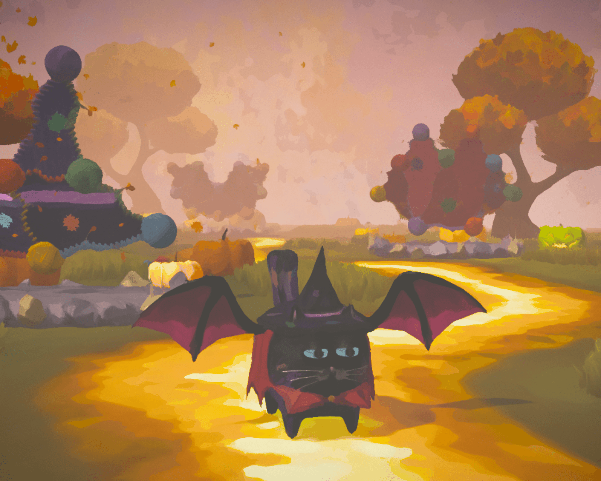

# Costume for Marcelino

Marcelino is a cat, and like any respectable cat, he needs a Halloween costume.

In this small 3D browser game you walk him around an autumn garden and solve an Eulerian path puzzle at each pedestal.
Each solved puzzle knits another piece of his costume, until he's ready for trick-or-treating.

[Live](https://fremorie.github.io/halloween/)



## Getting Started

```bash
npm run dev
# or
yarn dev
# or
pnpm dev
# or
bun dev
```

Open http://localhost:3000/halloween (the app runs under the `/halloween` base path, same as on GitHub Pages).

## Experiments

[Experiments](https://fremorie.github.io/halloween/experiments) is an index of the small test scenes used to build the game's pieces one at a time.

- [kuwahara](https://fremorie.github.io/halloween/kuwahara): the painterly Kuwahara post-processing filter, tested on a pile of pumpkins.
- [pumpkins](https://fremorie.github.io/halloween/pumpkins): the same pumpkins without the filter, with render stats, as a baseline.
- [rain](https://fremorie.github.io/halloween/rain) and [window](https://fremorie.github.io/halloween/window): a full-screen rain shader, then the same rain seen through a window in a wall.
- [yarn-balls](https://fremorie.github.io/halloween/yarn-balls): the yarn ball model and its materials.
- [eulerian-path](https://fremorie.github.io/halloween/eulerian-path): a puzzle graph built from yarn balls joined by branches.
- [jack-o-lantern](https://fremorie.github.io/halloween/jack-o-lantern), [2](https://fremorie.github.io/halloween/jack-o-lantern-2) and [3](https://fremorie.github.io/halloween/jack-o-lantern-3): three carved faces with an animated glow.
- [pedestal](https://fremorie.github.io/halloween/pedestal): the pedestal that holds each puzzle.
- [cat](https://fremorie.github.io/halloween/cat), [cat-rigged](https://fremorie.github.io/halloween/cat-rigged) and [cat-in-a-hat](https://fremorie.github.io/halloween/cat-in-a-hat): Marcelino with adjustable eyes, then rigged and animated, then wearing the hat.
- [tree](https://fremorie.github.io/halloween/tree) to [tree-v4](https://fremorie.github.io/halloween/tree-v4): four versions of the tree. v4 is the one in the game.
- [grass](https://fremorie.github.io/halloween/grass): the grass field with the paper-to-color reveal fully on.
- [ui](https://fremorie.github.io/halloween/ui): game UI components.

## Credits

### Kuwahara filter

Based on an article by Maxime Heckel: https://blog.maximeheckel.com/posts/on-crafting-painterly-shaders/

### Built with

three.js, React Three Fiber, Drei, Rapier, postprocessing, React Postprocessing, Three Custom Shader Material, Leva, GSAP, Radix UI, Zustand, Howler, NippleJS, Next.js, Tailwind, Blender, GIMP.

### Fonts

[Barrio](https://fonts.google.com/specimen/Barrio), [Dosis](https://fonts.google.com/specimen/Dosis) and [Alef](https://fonts.google.com/specimen/Alef) from [Google Fonts](https://fonts.google.com), used under the [SIL Open Font License](https://openfontlicense.org). Font pairing suggested by [Fontjoy](https://fontjoy.com).

### Sound

- Theme music (`public/sound/theme.mp3`) generated with [Suno](https://suno.com) on the free plan, for non-commercial use only. It is not covered by the MIT license; see [LICENSE](LICENSE).
- Meow sound (`public/sound/meow.mp3`): ["Cute Cat"](https://pixabay.com/sound-effects/nature-cute-cat-352656/) by Stu9 from [Pixabay](https://pixabay.com), used under the [Pixabay Content License](https://pixabay.com/service/license-summary/). It is not covered by the MIT license; see [LICENSE](LICENSE).
- Magic spell sound (`public/sound/magic-spell.mp3`): ["Mystical Wind Chimes Transition FX"](https://pixabay.com/sound-effects/film-special-effects-mystical-wind-chimes-transition-fx-6327/) by djlprojects (Freesound), shared by freesound_community on [Pixabay](https://pixabay.com), used under the [Pixabay Content License](https://pixabay.com/service/license-summary/). It is not covered by the MIT license; see [LICENSE](LICENSE).
- Footsteps sound (`public/sound/footsteps.mp3`): [Animal Footsteps](https://freesound.org/s/658429/) by [IENBA](https://freesound.org/people/IENBA/) -- https://freesound.org/s/658429/ -- License: [Creative Commons 0](https://creativecommons.org/publicdomain/zero/1.0/).
- Cape sound (`public/sound/cape.mp3`): ["Clothes drop 2"](https://pixabay.com/sound-effects/household-clothes-drop-2-40202/) by ZoviPoland (Freesound), shared by freesound_community on [Pixabay](https://pixabay.com), used under the [Pixabay Content License](https://pixabay.com/service/license-summary/). It is not covered by the MIT license; see [LICENSE](LICENSE).
- Whoosh sound (`public/sound/whoosh.mp3`): ["Cinematic Whoosh 3"](https://pixabay.com/sound-effects/cinematic-whoosh-3-467473/) by DRAGON-STUDIO from [Pixabay](https://pixabay.com), used under the [Pixabay Content License](https://pixabay.com/service/license-summary/). It is not covered by the MIT license; see [LICENSE](LICENSE).
- Birds sound (`public/sound/birds.mp3`): [Early_morning_birds_04.mp3](https://freesound.org/s/511758/) by [aladar](https://freesound.org/people/aladar/) -- https://freesound.org/s/511758/ -- License: [Attribution 3.0](https://creativecommons.org/licenses/by/3.0/). It is not covered by the MIT license; see [LICENSE](LICENSE).
- Sewing machine sound (`public/sound/sewing-machine.mp3`): trimmed excerpt of ["028693_sewing machine"](https://pixabay.com/sound-effects/household-028693-sewing-machine-75851/) by freesound_community from [Pixabay](https://pixabay.com), used under the [Pixabay Content License](https://pixabay.com/service/license-summary/). It is not covered by the MIT license; see [LICENSE](LICENSE).
- Wing flap sound (`public/sound/wing-flap.mp3`): four flaps cut from ["Heavy Wings Flapping"](https://pixabay.com/sound-effects/film-special-effects-heavy-wings-flapping-364607/) by DRAGON-STUDIO from [Pixabay](https://pixabay.com), used under the [Pixabay Content License](https://pixabay.com/service/license-summary/). It is not covered by the MIT license; see [LICENSE](LICENSE).
- Purr sound (`public/sound/cat-purr.mp3`): trimmed excerpt of ["Cat Perfect Purr"](https://pixabay.com/sound-effects/nature-cat-perfect-purr-54580/) by cristinaadrn (Freesound), shared by freesound_community on [Pixabay](https://pixabay.com), used under the [Pixabay Content License](https://pixabay.com/service/license-summary/). It is not covered by the MIT license; see [LICENSE](LICENSE).
